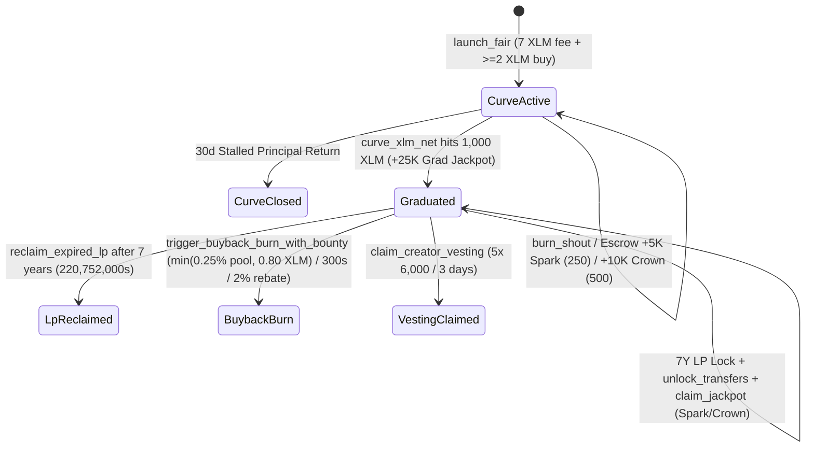

# AstroGate System Architecture

This document explains how AstroGate's smart contracts, client application, AstroWallet SSO custody integration, Soroswap AMM integration, decoupled Sorobits SEP-50 NFTs, and Telegram Worker fit together.

---

## 1. Design Principles

1. **Zero User Backend**: Authentication is strictly cryptographic (Ed25519 wallet signatures). There are no sessions, JWTs, or custodial user databases.
2. **Chain as Source of Truth**: Reserves, curve state, balances, ownership status, LP burns, and shouts are fetched from Soroban RPC and Stellar Horizon.
3. **Anti-Rug by Construction**: Fair launches fix supply at `10,000,000` (`7` decimals), renounce ownership immediately on deployment, lock P2P transfers until graduation, and time-lock `100%` of initial Soroswap LP tokens inside the Launchpad contract for `7 years` (`reclaim_expired_lp`; legacy tokens locked LP in `GAAAA...WHF`).
4. **Network Isolation**: `frontend/src/lib/network.ts` encapsulates `NETWORK_PRESETS` (`testnet` vs `mainnet`), dynamically switching RPC pools, contract IDs, explorers, and browser storage namespaces via `networkStorageKey(...)`.

---

## 2. Smart Contract Topology (`contracts/`)

### 2.1 `contracts/launchpad` (`astro-launchpad-contract`)
- **Curve Math (`quote_buy` / `quote_sell`)**:
  - Constant-product virtual curve initialized at `1,000 vXLM` and `6,600,000` curve tokens (`13,200,000` initial virtual tokens) until `curve_xlm_net == 1,000 XLM` (`2,000 vXLM` effective end, `4.00x` spot appreciation, `0.00%` graduation cliff).
  - 3-stage softened gamified fees & 3-Checkpoint Jackpot Ladder (`40,000` total prizes = `0.40%` supply) along `0 -> 1,000 XLM`:
    - Stage 1 (`< 250 XLM`, 0–25%): buy `0.30%` (`20 + 10 bps`), sell `1.20%` (`30 + 90 bps`). Breaking `250 XLM` escrows `+5,000` Spark Bonus (`burn_milestone_stage = 1`, claimable via `claim_jackpot` after graduation).
    - Stage 2 (`250–500 XLM`, 25–50%): buy `0.50%` (`30 + 20 bps`), sell `1.80%` (`40 + 140 bps`). Breaking `500 XLM` escrows `+10,000` King Crown (`burn_milestone_stage = 2`, claimable via `claim_jackpot` after graduation).
    - Stage 3 (`500–1,000 XLM`, 50–100%): buy `0.25%` (`15 + 10 bps`), sell `1.50%` (`30 + 120 bps`). Breaking `1,000 XLM` awards `+25,000` Graduation Jackpot.
  - Exact final buy exceeding graduation caps input at the remaining `1,000 - curve_xlm_net` delta.
- **Graduation (`seed_soroswap_and_burn_lp`)**:
  - Unlocks P2P transfers on the token (`unlock_transfers`).
  - Verifies Soroswap pair does not already hold liquidity (`pair.total_supply() > 0 || (r0 > 0 && r1 > 0)`), preventing 1-stroop `pair.sync()` griefing while still defeating pre-seeded LP dilution.
  - Transfers `>= 1,000 XLM` + `3,300,000` tokens (`33%`) directly into the Soroswap Pair, calls `deposit(&this)` so LP stays locked in the Launchpad contract for 7 years, awards `25,000` (`0.25%`) Graduation Jackpot to the final buyer, unlocks escrowed checkpoint jackpots (`claim_jackpot`), and releases `30,000` (`0.30%`) to `treasury`.
- **Post-Graduation Flywheel & Anti-MEV**:
  - `reclaim_expired_lp`: allows reclaiming expired contract-locked LP to `treasury` only after `graduated_at + 7 * 365 * 86_400` (`220,752,000s`).
  - `trigger_buyback_burn` / `trigger_buyback_burn_with_bounty`: permissionless Soroswap XLM -> Token swap + immediate `token.burn()`, chunk-capped at `min(0.25% of pool XLM reserve, 0.8000000 XLM)` with a `300s` per-token cooldown (`BuybackLastTs`) to prevent sandwich MEV extraction, plus a `2%` XLM keeper rebate (`<= 0.05 XLM`).
  - `claim_creator_vesting`: `30,000` tokens (`0.3%`, `5` tranches of `6,000` every `3` days) + creator's initial `launch_fair` paid seed unlocked at graduation (or `7 days` after launch if stalled; `CurveClosed` allows 30-day contributor principal return).
- **Governance & Safety**:
  - Admin address initialized to `treasury`, supports 2-step `transfer_admin`/`accept_admin`, emergency `set_paused` (pauses new launches only; exits/sells/claims remain open), `set_treasury`, `set_token_wasm_hash`, and a mandatory 48-hour upgrade timelock (`propose_upgrade`, `execute_upgrade`, `cancel_upgrade`, `get_pending_upgrade`).

### 2.2 `contracts/token` (`astro-token`)
- Built on OpenZeppelin `stellar-tokens 0.8.0` (`Capped`, `TotalSupply`, `FungibleBurnable`, `Ownable`).
- **Curve Transfer Lock**: During active curve (`lock_until_graduated(gate)`), `transfer` and `transfer_from` reject P2P movements (only the Launchpad gate can move curve tokens). `burn` and `burn_from` stay enabled so `burn_shout` works on the curve. Once `unlock_transfers()` executes at graduation, standard SEP-41 transfers open permanently.
- **TTL Preservation**: `extend_ttl` bumps instance TTL, `TotalSupply`, creator/lock metadata; `approve` also refreshes TTLs.

### 2.3 `contracts/sorobits` (`astro-sorobits-contract`) — Decoupled for Pillar 4 NFT Marketplace
- SEP-50 NFT contract rendering deterministic `32×32` pixel SVG (`render_svg`, `animated_svg`) from RLE-compressed trait bitmaps (`validate_rle_render_budget` bounds `<= 720` runs and `<= 12,800` SVG bytes), with dynamic Season 2+ layer/palette counts and 48-hour upgrade timelock (`propose_upgrade`/`execute_upgrade`/`cancel_upgrade`).
- Supports standalone Pillar 4 operation via `set_launchpad_optional(Option<Address>)` and Launchpad-independent quest progression in `claim_quest_badge` (`CapsulesMinted` & collection count) alongside Launchpad telemetry when linked; frontend `src/lib/sorobits.ts` has zero compile-time coupling to Launchpad `token.ts` and surfaces standalone `buildSorobitsMarketplaceUrl` CTAs.
- Edition-0 Genesis Archetypes (`AGQ01–AGQ08`), two-ledger commit-reveal RNG (`commit_capsule`/`reveal_capsule`, `commit_forge`/`reveal_forge`), and `TokenBaseXp` anti-XP-laundering protection alongside role-gated epigenetic `rank_tier` / `xp_score` progression.
- `tokens_of_page(owner, offset, limit)` paginated enumeration and `extend_token_ttl` asset TTL refreshing.

---

## 3. Frontend & Exclusive `AstroWallet` Custody Integration (`frontend/src/`)

- **Exclusive Pillar 1 `AstroWallet` SSO + AstroConnect v1 Clear-Sign (`src/store/wallet.ts`, `src/lib/signer.ts`):**
  - `MiniAppShell.tsx` and `WalletButton.tsx` delegate authentication and transaction signing exclusively to `AstroWallet` (`AstroID` SSO + `/api/v1/wallet/connect/requests*` Clear-Sign proxy over `env.ASTROWALLET`, removing `<HotWalletModal />` and Reown `WalletConnectModule` runtime dependencies while retaining disposable Testnet `Demo` accounts and browser kit fallback).
  - Inside Telegram Mini App, `hydrateFromTelegramCloud` auto-resolves `AstroID` (`GET /api/v1/wallet/resolve?q=<tgUserId|@username>`) with zero clicks and routes `mode: 'wallet'` signatures through `astroWalletConnectSigner`.
  - Worker `resolveWalletIdentity` (`frontend/worker/wallet.ts`) strictly prioritizes `env.ASTROWALLET` (`resolveFromAstroWalletDirectory`) before consulting fallback `ASTRO_KV` records.
- **Stellar Reserve Validation (`src/lib/xlm.ts`)**:
  - Reads exact `subentry_count`, `num_sponsoring`, `num_sponsored`, and `selling_liabilities` from Horizon to enforce `(2 + subentries + sponsoring - sponsored) * 0.5 XLM + liabilities + 0.5 XLM` fee headroom before signing.
- **Multi-RPC Failover (`src/lib/network.ts`)**:
  - `executeWithRpcFailover` rotates healthy endpoints on 429/5xx/timeouts with bounded backoff; `Soroswap` and `Sorobits` modules read directly from chain (`Pair.token_0()`, `Pair.token_1()`, `Pair.get_reserves()`).
- **Local Caching & IndexedDB (`src/lib/indexed-db.ts`, `snapshots.ts`, `launch-checkpoint.ts`)**:
  - All storage keys and IndexedDB databases are scoped by active network via `networkStorageKey(...)` so Testnet and Mainnet state never collide.

---

## 4. Cloudflare Pages Functions & Worker (`frontend/functions/`, `frontend/worker/`)

- **Unified Domain Architecture (`https://astrogate.pages.dev`)**:
  - Static SPA assets (`/*`) are served directly from Cloudflare Pages edge CDN.
  - Dynamic routes (`/telegram/webhook`, `/api/*`, `/mcp`, `/openapi.json`, `/health`, `/.well-known/stellar.toml`) are routed via thin Cloudflare Pages Functions (`frontend/functions/`) over an internal `ASTROW` Service Binding to the `astrogate-stellar` Worker (`workers_dev: false`), keeping same-origin API calls free of CORS overhead and running the `*/5 * * * *` Soroban event cron inside `astrogate-stellar`.
- **Separation of Chat Roles**:
  - **`@AstroGateFeed`** (`TELEGRAM_FEED_CHAT_ID`): Receives ALL automated spam-filtered protocol alerts (`launch`, buys/sells `>= 2 XLM`, `>= 80%` near-graduation pushes, graduations, DEX buybacks, Stage-2 milestones, Burn-to-Chat shouts, Sorobits mints & rank evolutions).
  - **`@AstroGateCommunity`** (`TELEGRAM_COMMUNITY_CHAT_ID`): **Zero automated broadcasts** (`community: false` for all parsed contract events). Responds strictly to interactive commands (`/market`, `/king`, `/token`, `/wallet`, `/wallet @user`, `/quests`, `/sorobits`, etc.), `$TICKER` lookups, and secret-seed auto-deletion guards.
- **Wallet Directory & Encrypted Sync API (`frontend/worker/wallet.ts`, `api.ts`, `mcp.ts`)**:
  - `POST /api/v1/wallet/link`: Enforces verified `X-Telegram-Init-Data` (`401` on unverified `tgUserId > 0`, `403` against unverified `@username` overwrites), `±300s` Ed25519 signature (`decodeStellarPublicKey` + WebCrypto `Ed25519`), anti-replay nonce (`wnonce:` in KV), restricted CORS (`walletCorsHeaders`), sliding-window IP rate limit (`15/min`), and fail-closed `S...` secret leak check before storing network-scoped links.
  - `GET /api/v1/wallet/resolve?q=...`: Resolves `@username`, `G...`, or numeric `tgUserId` to its `primaryPublicKey` (never returns `encryptedVaultBundle`; `Cache-Control: no-store`). Also exposed to AI agents via MCP tool `resolve_wallet`.
  - `GET /api/v1/wallet/vault`: Requires verified `X-Telegram-Init-Data` (300s window) with restricted CORS (`walletCorsHeaders`) and returns the authenticated user's `AGVAULT1` encrypted bundle and link metadata.
- **Security Controls**:
  - Webhook requests require constant-time verification of `X-Telegram-Bot-Api-Secret-Token`.
  - `/api/telegram/pulse` enforces an explicit CORS origin allowlist (no wildcard `*.workers.dev`), optional `Telegram.WebApp.initData` HMAC-SHA256 verification (`verifyTelegramInitData` in `telegram-auth.ts`), 5-second per-IP rate limiting, single-claim pulse tx deduplication (`pulse:tx:<hash>`), and a 180-ledger tx recency window; `/mcp` caps JSON-RPC batch arrays at `10`.
  - Supports Cloudflare KV (`ASTRO_KV`) for persistent event deduplication, wallet directory indexes, anti-replay nonces, and cursor tracking across Worker isolates.
