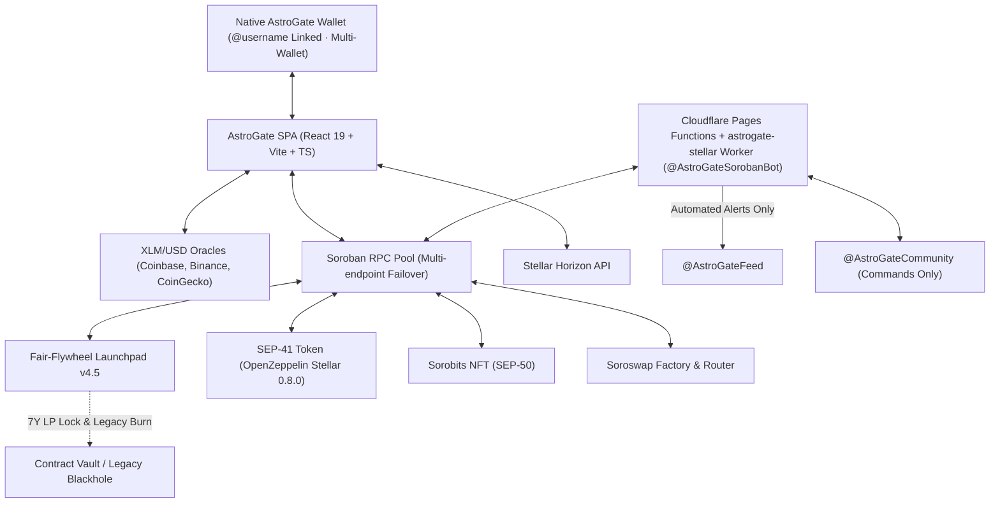

# AstroGate 🌊🚀 — Stellar Fair-Flywheel Launchpad, AMM & Sorobits

AstroGate is a decentralized, zero-backend Fair-Launchpad, AMM interface, and on-chain collectible platform built natively on **Stellar / Soroban**.

- **Zero Custodial Backend**: Identity = native self-custodial Stellar Wallet (`PBKDF2-SHA256` + `AES-GCM-256` vault synced via `Telegram.WebApp.CloudStorage` and encrypted `AGVAULT1:` bundles, linked cryptographically to Telegram `@username` via Ed25519 proofs, with exportable `S...` seeds). State & pricing = Stellar Horizon + Soroban RPC directly.
- **Fair-Flywheel v4.5 Launchpad** (`7 XLM` protocol fee + `>= 2 XLM` initial creator curve buy):
  - Fixed `10,000,000` supply (`7` decimals, aligned with `1 XLM = 10^7` stroops) and **immediate `renounce_ownership()`** on launch.
  - **66.0% (`6,600,000`)** Virtual Bonding Curve (`1,000 vXLM -> 1,000 real XLM` graduation target, `4.00x` curve range): softened 3-stage buy fees (`0.30%` `<250 XLM`, `0.50%` `250–500 XLM`, `0.25%` sprint `500–1,000 XLM`), gentle sell fees (`1.20% -> 1.80% -> 1.50%`), and P2P transfers locked until graduation.
  - **33.0% (`3,300,000`)** Soroswap DEX Pool Reserve seeded automatically at graduation (`0.00%` price cliff) with **100% LP time-locked inside the Launchpad contract for 7 years** (`reclaim_expired_lp` thereafter).
  - **0.3% (`30,000`)** 15-day post-graduation creator vesting (`5 × 6,000` every 3 days), plus creator's initial curve seed locked until graduation (or 7-day stalled fallback).
  - **0.40% (`40,000`)** Escrowed 3-Checkpoint Jackpot Ladder (`+5,000` Spark at `250 XLM` and `+10,000` King Crown at `500 XLM` escrowed in-contract until graduation via `claim_jackpot`; `+25,000` Graduation Jackpot at `1,000 XLM`).
  - **0.30% (`30,000`)** Developer / Protocol Ecosystem allocation transferred to `treasury` on graduation.
  - **Anti-MEV Deflation & 48h Governance**: chunked DEX Buyback & Burn (`trigger_buyback_burn` / `trigger_buyback_burn_with_bounty` capped at `min(0.25% pool, 0.8000000 XLM)` per `300s` with `+2%` XLM keeper rebate), 3-tier Burn-to-Chat (`burn_shout`), and 48h contract upgrade timelock (`propose_upgrade`/`execute_upgrade`/`cancel_upgrade`).
- **Sorobits (SEP-50) On-Chain Pixel Collectibles**: `32×32` deterministic & generative pixel avatars rendered natively on-chain via RLE + SVG (`render_svg`, `animated_svg`) with 256-bit genomes (`BytesN<32>`), commit-reveal RNG (`commit_capsule`/`reveal_capsule`, `commit_forge`/`reveal_forge`), epigenetic XP/rank evolution, free Soulbound `AGQ01` Pioneer badge, and 48h upgrade timelock.
- **Telegram-Only Mini App & Live Feed Bot (`@AstroGateSorobanBot`)**: External browsers receive a clean presentation landing page redirecting into Telegram; the trading/wallet `MiniAppShell` loads strictly after Worker-side HMAC-SHA256 `initData` session verification (`POST /api/telegram/session`, 24h TTL). Interactive commands run in `@AstroGateCommunity` while automated on-chain alerts & digests stream strictly to `@AstroGateFeed`.

---

## Documentation Map (Developers, Auditors & AI Agents)

| Document | Purpose |
| :--- | :--- |
| [AGENTS.md](./AGENTS.md) | Repository onboarding, invariants & build gates for autonomous AI coding/auditing agents |
| [ARCHITECTURE.md](./ARCHITECTURE.md) | End-to-end architecture, state machines, cryptography, RPC failover, and Telegram event pipeline |
| [AUDIT_GUIDE.md](./AUDIT_GUIDE.md) | Security audit playbook & invariant checklist for human auditors and AI auditing agents |
| [SECURITY.md](./SECURITY.md) | Trust boundaries, implemented controls, known limitations, and vulnerability disclosure |
| [CONTRIBUTING.md](./CONTRIBUTING.md) | Development workflow, Rust/TS quality gates, and PR standards |
| [TRADEMARK.md](./TRADEMARK.md) | Brand, logo, and anti-phishing usage policy (source code is MIT; brand marks belong to NunaLabs) |
| [docs/AI_AGENT_INTEGRATION.md](./docs/AI_AGENT_INTEGRATION.md) | SDK usage & function-calling schemas for autonomous AI agents |
| [frontend/public/llms.txt](./frontend/public/llms.txt) | Concise LLM-readable protocol index served at `/llms.txt` (full context at `/llms-full.txt`) |

---

## Architecture Overview



---

## Live Testnet Contracts & Endpoints

> AstroGate is currently running on **Stellar Testnet** (`Test SDF Network ; September 2015`). Do **not** treat testnet contracts as mainnet-audited.

| Component | Testnet Identifier |
| :--- | :--- |
| **Soroban RPC** | `https://soroban-testnet.stellar.org` |
| **Horizon API** | `https://horizon-testnet.stellar.org` |
| **Launchpad Contract (v4.5)** | `CB5VMDAPQUK5LT5LH5L5THI6XYYUBTAXM7BJZLZYFGUJHZB64LZHFAPK` |
| **Launchpad WASM Hash (v4.5 deployed)** | `9db8d446725715069d85c51c4fb1b897bb93d036507a6b95fe085c64f4aaa4e9` |
| **Token WASM Hash (v4.2 deployed)** | `bc3ababa6a10d8385101ac29ecdac84e9375d628df190c0f4f88defe4544f0e6` |
| **Flagship Token ($ASTRO)** | `CAI637WCEILQF3ZYOV6BRUCX532XQIVOOJ4CRWFPWHQRJHOH5OKHSXRE` |
| **ASTRO / XLM Soroswap Pair** | `CA32TMZ2AODXI7K7B6T2YPZR52HJKFCY5GT2DNHMOL326DLSNPX55BUP` |
| **Sorobits NFT Contract (SEP-50, v4.5)** | `CBVETCPLVAMNUUQRUJGH54XHVQT5ZOVB4FGGP2IGOGAZLUIYBBV7G3I3` |
| **Sorobits WASM Hash (v4.5 deployed)** | `bc5c0d36b9add840685f734709a32945a88e0353d49b57b938d54ae68a7d5adf` |
| **Soroswap Factory** | `CDP3HMUH6SMS3S7NPGNDJLULCOXXEPSHY4JKUKMBNQMATHDHWXRRJTBY` |
| **Soroswap Router** | `CCJUD55AG6W5HAI5LRVNKAE5WDP5XGZBUDS5WNTIVDU7O264UZZE7BRD` |
| **Native XLM SAC** | `CDLZFC3SYJYDZT7K67VZ75HPJVIEUVNIXF47ZG2FB2RMQQVU2HHGCYSC` |
| **Anti-Rug Burn Address** | `GAAAAAAAAAAAAAAAAAAAAAAAAAAAAAAAAAAAAAAAAAAAAAAAAAAAAWHF` |

---

## Local Development & Verification

### Prerequisites
- Node.js `>= 22`, npm
- Rust toolchain + `wasm32v1-none` target + `stellar-cli` (`>= 25`)

### Quick Start
```bash
git clone https://github.com/NunaLabsDev/astrogate.git
cd astrogate/frontend
npm ci
npm run dev   # http://localhost:5173 (includes /docs Developer & Audit Hub)
```

### AI Integration, Public API & MCP Server
- **Developer & Audit Hub UI**: `/docs` (live protocol lifecycle, audited controls, Stellar best practices, REST/MCP/SDK snippets)
- **Public REST API**: `GET /api/v1/health`, `GET /api/v1/tokens`, `GET /api/v1/tokens/:id`, `GET /api/v1/tokens/:id/audit`, `GET /api/v1/tokens/:id/quote`, `GET /api/v1/sorobits`, `GET /api/v1/wallet/resolve?q=@username`, `POST /api/v1/wallet/link`, `GET /api/v1/wallet/vault`, `GET /openapi.json`
- **Model Context Protocol (MCP)**:
  - Remote Worker HTTP endpoint: `POST /mcp`
  - Local Stdio server (`zero-config`, connects directly to Soroban RPC): `cd frontend && npm run mcp`
- **LLM Specs**: `/llms.txt` & `/llms-full.txt`

### Full Quality & Audit Gates
```bash
# Smart contracts: build astro-token WASM fixture first, then formatting, clippy & unit tests
stellar contract build --package astro-token
cargo fmt --all -- --check
cargo clippy --workspace --all-targets -- -D warnings
cargo test --workspace
stellar contract build

# Frontend & Cloudflare Worker: TypeScript, Vite build, lint, 227+ Vitest specs, SSR smoke, PWA, CSP parity
cd frontend
npx tsc --noEmit -p tsconfig.worker.json
npm run check

# Live read-only / disposable-account Testnet E2E checks (no STELLAR_SECRET required)
npm run verify:discovery
npm run verify:token-events
npm run verify:demo
```

---

## License

Licensed under the [MIT License](./LICENSE).
