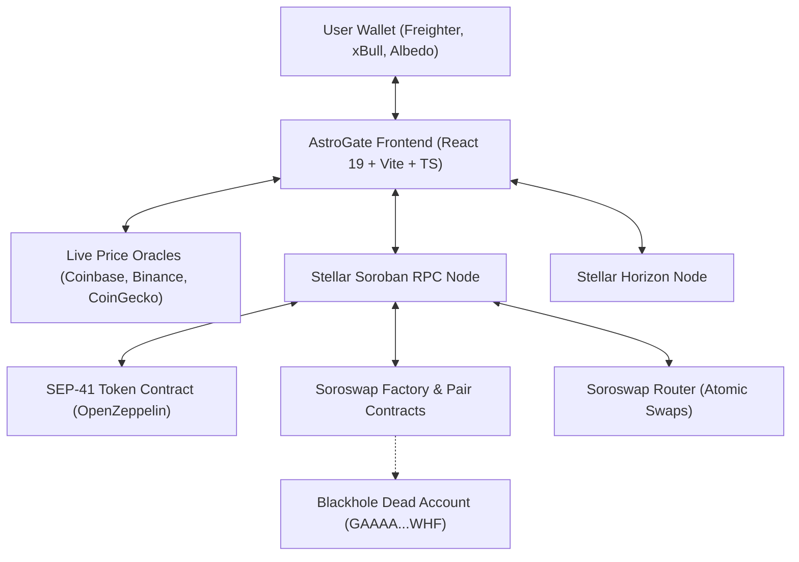

# AstroGate 🌊🚀 — Stellar Fair Launchpad & AMM

AstroGate is a decentralized, zero-backend Fair Launchpad and automated market maker (AMM) built natively on Stellar/Soroban. It introduces fair, anti-rug memecoin launch mechanics to the Stellar ecosystem:

- **Zero Protocol Deploy Fee**: Deploy a Fair-Flywheel launch for your initial curve buy (`>= 2 XLM`) + standard Stellar network gas (~0.05 XLM).
- **Fair-Flywheel v4 Allocation (`40 / 30 / 29.7 / 0.3`)**: `4,000,000` (`40%`) Virtual Bonding Curve (`3,000 vXLM → 1,000 XLM` goal) · `3,000,000` (`30%`) Soroswap DEX Reserve (`0.00%` graduation cliff) · `2,970,000` (`29.7%`) Milestone Proof-of-Burn Vault · `30,000` (`0.3%`) 15-day post-graduation creator vesting (5 tranches × 6,000 every 3 days).
- **Anti-Whale Progressive Vault + Dual Proof-of-Burn & Registry**: Curve buys `> 2%` of virtual XLM add up to `+5.00%` straight into `real_xlm_vault`; at graduation (`1,000 XLM`), `100%` Soroswap LP is burned to `GAAAA...WHF`, Stage 1 burns `1,485,000` tokens via `token.burn()`, and Stage 2 permissionlessly burns `1,485,000` at `>= 2,500 XLM` DEX depth (`get_launches`, `get_curve`).
- **Permanent Mint Freezing & 3-Tier Burn-to-Chat + King Shout**: Contract ownership is renounced immediately on launch (`renounce_ownership`), token supply is sealed via OpenZeppelin `Capped`, and traders burn tokens (`>= 25` Chat, `250` Hype, `>= 1,000` pinned King Shout) directly via `burn_shout`.
- **Real-Time Live Pricing & 0ms Quotes**: Multi-source XLM oracle waterfall combined with instant deterministic `997/1000` constant-product AMM math and RPC failover across testnet nodes. Zero mock data.
- **Zero-Backend Architecture**: Identity = non-custodial wallet (`@creit.tech/stellar-wallets-kit`) or 1-click Testnet Demo keypair. Data = Stellar Horizon + Soroban RPC.

---

## Architecture Overview



---

## Live Contracts & Testnet Deployment

| Component | Testnet Contract / Address |
| :--- | :--- |
| **RPC Endpoint** | `https://soroban-testnet.stellar.org` |
| **Horizon Endpoint** | `https://horizon-testnet.stellar.org` |
| **Flagship Token ($ASTRO)** | `CAI637WCEILQF3ZYOV6BRUCX532XQIVOOJ4CRWFPWHQRJHOH5OKHSXRE` |
| **Token WASM Bytecode Hash** | `a47dc064f7a072476fbbd612be98ce13d691b178b81a40ebdf4b2ec78f65c9f7` |
| **Fair-Flywheel Launchpad Contract (v4)** | `CA343KTSUBOUABOVP7AHYMRKHJ3LD4OI3HTYXMCIS3USR3HK2L6LTRHV` |
| **Launchpad WASM Bytecode Hash (v4)** | `30d39cf397f3f9037564a97252104331a8f7e6001db3b8405608bf2d81a95007` |
| **Soroswap Factory** | `CDP3HMUH6SMS3S7NPGNDJLULCOXXEPSHY4JKUKMBNQMATHDHWXRRJTBY` |
| **Soroswap Router** | `CCJUD55AG6W5HAI5LRVNKAE5WDP5XGZBUDS5WNTIVDU7O264UZZE7BRD` |
| **XLM SAC (Stellar Asset Contract)** | `CDLZFC3SYJYDZT7K67VZ75HPJVIEUVNIXF47ZG2FB2RMQQVU2HHGCYSC` |
| **Anti-Rug Burn Address** | `GAAAAAAAAAAAAAAAAAAAAAAAAAAAAAAAAAAAAAAAAAAAAAAAAAAAAWHF` |
| **Developer Treasury (Testnet)** | `GDQT2KMQ5I2EFDK3WG42YBHRIC4B7OXL7K2G3IC2Z6LPTJEEOMXD7NQE` |

---

## Key Features

1. **Fair Launch Form (`/create`)**:
   - Minimalist launchpad (`launch_fair`): Name, Ticker, Seed XLM, live SVG preview, and optional collapsed off-chain links encoded in on-chain `meta` (`≤ 512` bytes).
   - Fixed 10M supply (7 decimals, aligned with 1 XLM = 10^7 stroops; min 2 XLM initial curve buy): locks `40%` on the `3,000 vXLM → 1,000 XLM` Virtual Bonding Curve, `30%` Soroswap DEX Reserve, `29.7%` Proof-of-Burn Vault (`1.485M` on graduation + `1.485M` at `2,500 XLM`), and `0.3%` 15-day post-graduation creator vesting, while renouncing mint authority atomically.
2. **Instant Curve & AMM Trading, King Shout & Audit (`/token/:id`)**:
   - Seamless deterministic quotes against either the Fair-Flywheel Bonding Curve (pre-graduation) or Soroswap DEX pools (post-graduation) with dynamic anti-whale / slippage guards and permissionless `trigger_milestone_burn` / `claim_creator_vesting`.
   - 3-tier Burn-to-Chat (`burn_shout`, `get_king_shout`), live ledger activity feed, and **Audit & Contract** tab with 90-day TTL refresh (`extendTokenTtl`).
3. **Live Pump-Style Market Feed (`/`, `/market`)**:
   - Discovers tokens directly from the Launchpad v4 on-chain registry (`get_launches`, `get_curve`) merged with Soroswap factory events (no external DB needed).
   - Features King of the Hill spotlight, Fair Launchpad verified filter (`✓ Fair`), instant search, and watchlist.
4. **Local Portfolio & Data Export (`/portfolio`)**:
   - View created tokens, user holdings, and local transaction activity.
   - Export full transaction history as CSV or JSON for personal records / auditing.
5. **1-Click Testnet Demo Wallet**:
   - Click `Testnet Demo` directly in the top wallet menu to generate and Friendbot-fund a disposable testnet account in one click.

---

## Local Development & Quick Start

```bash
# Clone repository
git clone https://github.com/ruwaq/astro-launchpad.git
cd astro-launchpad
git checkout main

# Install dependencies and start dev server
cd frontend
npm ci
npm run dev # http://localhost:5173
```

### Verification & Testing Gates

```bash
# Run full frontend quality gate (build + lint + tests + smoke SSR + PWA audit + CSP parity)
npm run check

# Run smart contract unit tests
cargo test -p astro-token
cargo test -p astro-launchpad-contract

# Run smart contract linter
cargo clippy -p astro-token --all-targets -- -D warnings

# Read-only live on-chain testnet verification (zero secret needed)
npm run verify:discovery     # Real pair discovery from Soroswap factory
npm run verify:demo          # 3 new Friendbot accounts + complete lifecycle flow
```

---

## Production Deployment

### Cloudflare Workers / Pages
Defined in `frontend/wrangler.jsonc` with static assets:
```bash
cd frontend
npm run build
npm run deploy # npx wrangler deploy
```

### Vercel Deployment
Pre-configured in `frontend/vercel.json` with strict Content-Security-Policy (CSP), HSTS, and cache headers:
```bash
vercel --prod
```

---

## Security Status

- **Verified via automated gates**: frontend strict typecheck, unit tests, lint, SSR smoke, PWA audit and CSP parity run on every `npm run check`; contract tests run with `cargo test`. No third-party security audit has been performed yet — do not rely on this repository as audited.
- **Smart Contracts**: built on audited OpenZeppelin Stellar components (`stellar-tokens 0.8.0`).
- **Anti-Rug Guarantee**: mathematically irrevocable LP lock to canonical dead address.
- **Content Security Policy**: strict headers applied across all deployment targets (parity enforced by `npm run check:csp`).
